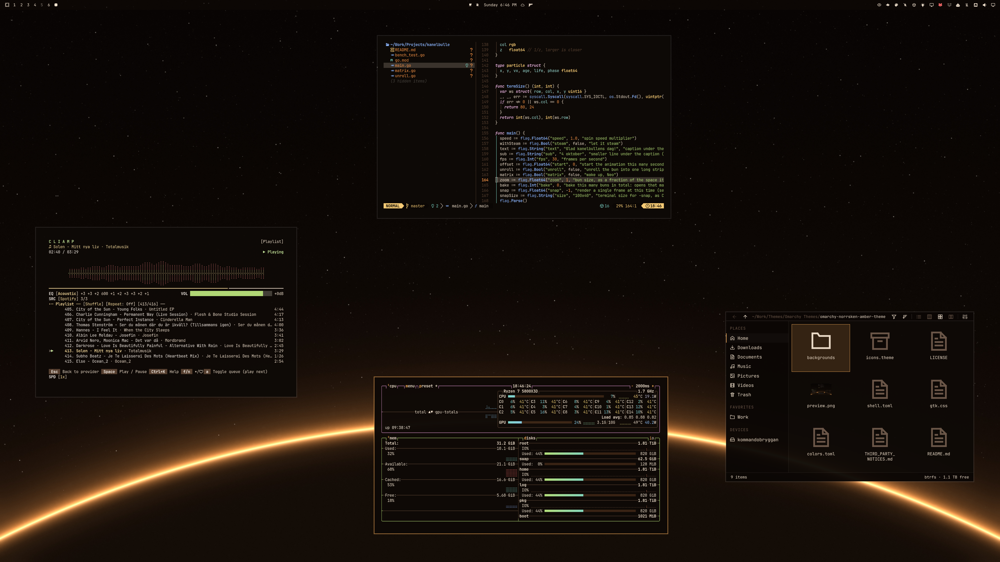
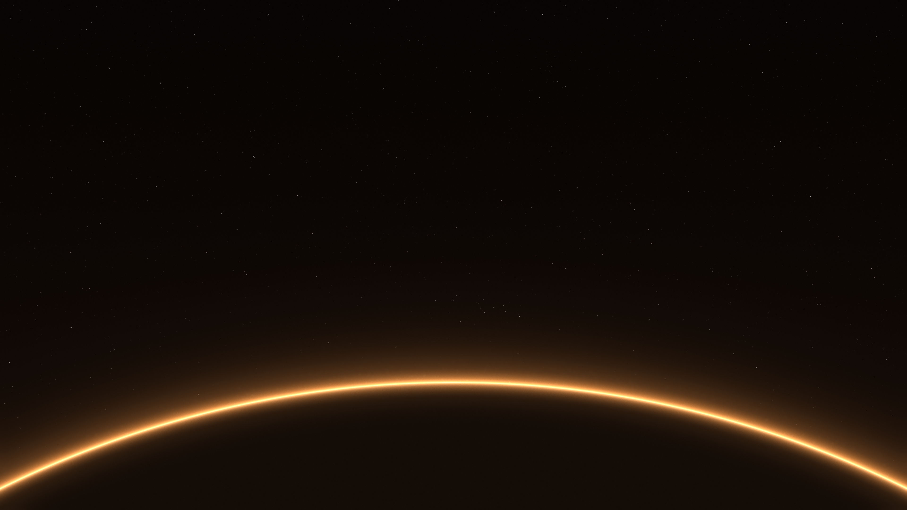

# Norrsken Amber

An amber variant of [Norrsken](https://github.com/ejuro/omarchy-norrsken-theme): warm amber on a deep brown-black, with coral-edged windows, a translucent glass shell, and a glowing planet horizon.



Neovim, the [cliamp](https://github.com/bjarneo/cliamp) music player, [Flea](https://github.com/ejuro/flea), and a terminal using Norrsken Amber with the full glass effect.

## Background

One **3840 × 2160** background: a thin amber planet edge against a star field with crisp pinpoint stars.

[](backgrounds/1-horisont.png)

## Install

```bash
omarchy theme install https://github.com/ejuro/omarchy-norrsken-amber-theme.git
```

Tested on Omarchy **4.0.4**.

### Full glass effect (optional)

Omarchy skips Lua from installed themes for safety, so the command above leaves out the frosted-glass windows, blur, rounded corners, and glow in [`hyprland.lua`](hyprland.lua). To add them, read that file, then run:

```bash
git clone https://github.com/ejuro/omarchy-norrsken-amber-theme.git ~/.local/share/omarchy-norrsken-amber-theme
rm -rf ~/.config/omarchy/themes/norrsken-amber
ln -s ~/.local/share/omarchy-norrsken-amber-theme ~/.config/omarchy/themes/norrsken-amber
omarchy theme set norrsken-amber
```

Terminals, the Omarchy agent and About windows, [Omawrite](https://github.com/ejuro/omawrite), and [Flea](https://github.com/ejuro/flea) turn to glass; everything else stays opaque.

## Palette

| Role | Color |
| --- | --- |
| Main surfaces | `#0e0906` |
| Raised surfaces | `#1a120c` |
| Text | `#f3e3cf` |
| Accent | `#ffb45e` |
| Border gradient | `#ffb45e` → `#ff7a6b` |
| Selection | `#3a2414` |
| Muted text | `#9a8470` |

## Customization and compatibility

`colors.toml` supplies the shared palette and the border gradient. Omarchy generates terminal and supported application configurations from it. `shell.toml` styles the shell surfaces as translucent glass, `gtk.css` styles GTK applications on setups that link GTK to the current theme, and `hyprland.lua` adds the optional glass effect. Update those files too when changing palette colors, then reapply the theme.

Norrsken Amber contains no application patches or install hooks.

## License

[MIT](LICENSE). Copyright (c) 2026 Erik Johansson.

Attribution for adapted upstream portions is recorded separately in [third-party notices](THIRD_PARTY_NOTICES.md).
