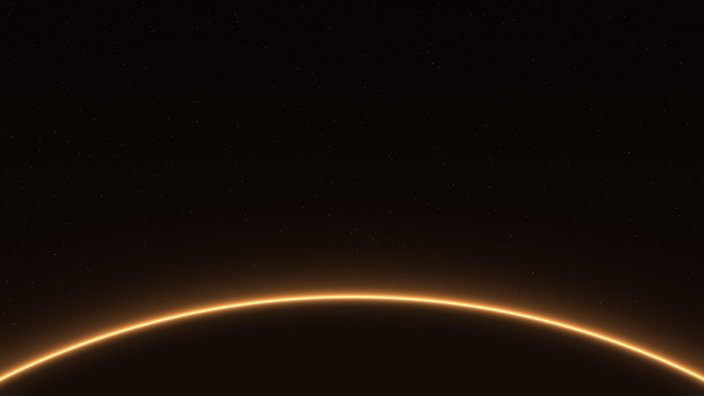

# Norrsken Amber

An amber variant of [Norrsken](https://github.com/erikrjohansson/omarchy-norrsken-theme): warm amber on a deep brown-black, with softly lit window edges, a translucent shell, and a glowing planet horizon.


Neovim, btop, and [Flea](https://github.com/erikrjohansson/flea) using Norrsken Amber.

## Background

One **6K (6016 × 3384)** background: a thin amber planet edge against a star field with crisp pinpoint stars.

[](backgrounds/1-horisont.jpg)

## Install

```bash
omarchy theme install https://github.com/erikrjohansson/omarchy-norrsken-amber-theme.git
```

Tested on Omarchy **4.0.4**.

## Update

To get new wallpapers and fixes, update your installed themes, then apply Norrsken Amber again so Omarchy picks up the new files:

```bash
omarchy theme update
omarchy theme set norrsken-amber
```

## Remove

Switch to another theme first (for example with `omarchy theme switcher`), then remove Norrsken Amber:

```bash
omarchy theme remove norrsken-amber
```

## License

[MIT](LICENSE). Copyright (c) 2026 Erik Johansson.

Attribution for adapted upstream portions is recorded separately in [third-party notices](THIRD_PARTY_NOTICES.md).
